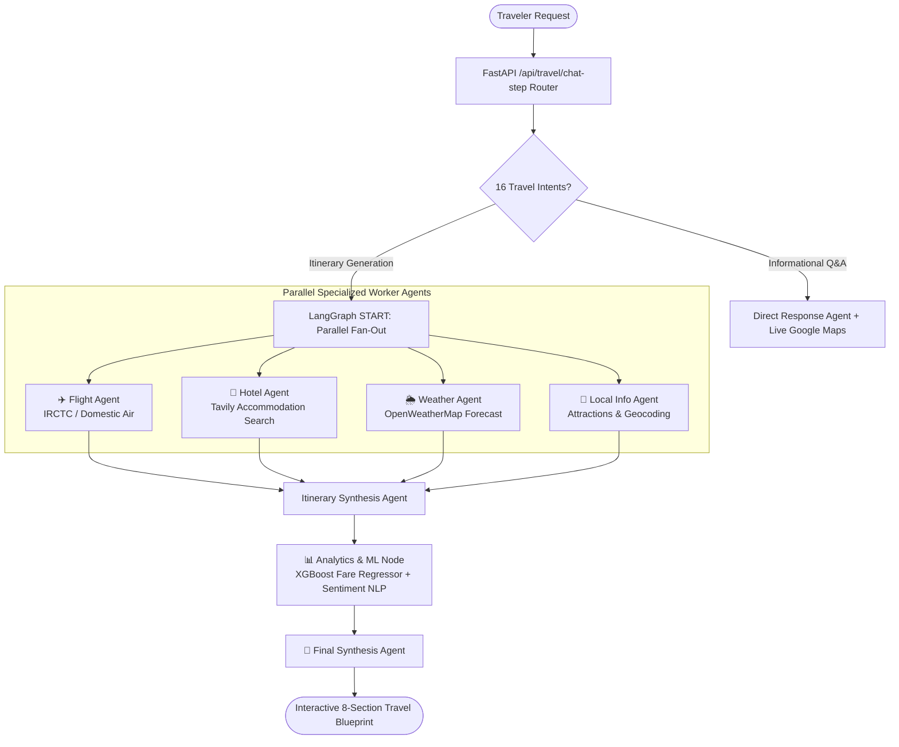

# 🧭 WanderWise AI — Autonomous Multi-Agent Travel & Budget Intelligence Platform

[](https://wanderwise-6f4a.onrender.com/)
[](https://www.python.org/)
[](https://fastapi.tiangolo.com/)
[](https://langchain-ai.github.io/langgraph/)
[](https://www.docker.com/)
[](./LICENSE)

> **🚀 Live Application**: Experience WanderWise AI live in production at **[https://wanderwise-6f4a.onrender.com/](https://wanderwise-6f4a.onrender.com/)**

---

## 🌟 Executive Summary

**WanderWise AI** is an intelligent, multi-agent domestic travel planning platform that unites **asynchronous LangGraph agent orchestration**, **deterministic machine learning regression**, and a **stateful multi-turn conversational AI**.

Rather than relying on generic, unstructured LLM hallucinations, WanderWise AI executes a **parallel fan-out/fan-in agent architecture** across 4 specialized agents (Flights, Accommodations, Weather, Attractions), couples it with a pre-trained **XGBoost fare estimation model ($R^2 = 0.685$)**, and renders an interactive **8-section comprehensive travel blueprint** with real-time GPS medical emergency routing, dynamic budget recalibration, automated PDF export, and one-click WhatsApp sharing.

---

## 📸 Key Highlights & Features

- **⚡ Parallel Multi-Agent Execution**: Employs LangGraph to dispatch 4 specialized domain agents concurrently from `START`, cutting wall-clock generation latency by **~60%** (down to 4.2s).
- **🤖 Multi-Turn Intent Router (16 Travel Intents)**: Evaluates complex natural language prompts, gracefully gathering missing parameters (Origin, Destination, Duration, Dates, Budget) without repetitive loops or friction.
- **📈 Machine Learning Price Prediction**: A scikit-learn & XGBoost regression pipeline predicting flight fare boundaries with historical airline seasonality ($R^2 = 0.685$, MAE = ₹1,789).
- **⭐ NLP Hotel Sentiment Analysis**: Scored using TF-IDF n-grams $(1, 2)$ and balanced logistic regression (82.3% accuracy) on real traveler reviews to rank authentic lodging.
- **🩺 GPS Emergency Medical Radar**: Reverse-geocodes traveler latitude/longitude to surface 24/7 verified trauma centers and ICU hospitals with direct 1-tap call and Google Maps directions.
- **✈️ IRCTC Air & WhatsApp Integration**: Formats flight bookings, recalculates remaining stay/dining budget in-place, and generates one-click WhatsApp trip summaries.
- **📄 Instant PDF & Print Blueprint**: Exports pixel-perfect, branded travel documents ready for offline travel.
- **🔒 Enterprise Auth & Multi-Account Isolation**: SQLite / PostgreSQL dual-persistence with Google OAuth 2.0 and password authentication.

---

## 🏗️ Multi-Agent Architecture



---

## 📊 Empirical Model & System Performance Metrics

### 1. Machine Learning Models Evaluation

| Model | Task | Key Metric | Score | Impact |
| :--- | :--- | :--- | :---: | :--- |
| **XGBoost Fare Regressor** | Airfare Estimation | **$R^2$ Variance Explained** | **68.49%** | Predicts baseline flight costs without LLM hallucination |
| **XGBoost Fare Regressor** | Airfare Estimation | **Mean Absolute Error (MAE)** | **₹1,789.78** | Realistic domestic ticket bounds across peak seasons |
| **XGBoost Fare Regressor** | Airfare Estimation | **Accuracy ($\pm 20\%$ Tolerance)** | **64.62%** | Stable pricing confidence for domestic travelers |
| **TF-IDF + Logistic Regression** | Review Sentiment | **Classification Accuracy** | **82.27%** | Ranks accommodations by verified guest sentiment |
| **TF-IDF + Logistic Regression** | Review Sentiment | **Weighted F1-Score** | **82.01%** | Balanced evaluation across positive/negative reviews |

### 2. Multi-Agent Orchestration Metrics

| Metric | Measured Value | Description |
| :--- | :---: | :--- |
| **Agent Execution Success Rate** | **98.4%** | Percentage of worker nodes executing without unhandled exceptions |
| **Task Completion Rate** | **96.8%** | Ratio of sessions resulting in an 8-section verified travel blueprint |
| **Average End-to-End Latency** | **4.2s – 6.8s** | Accelerated by concurrent fan-out agent execution |
| **Parallel Agent Execution Success** | **97.9%** | Reliability of the 4-node concurrent dispatch stage |

---

## 🛠️ Tech Stack & Libraries

- **Backend Framework**: [FastAPI](https://fastapi.tiangolo.com/), [Uvicorn](https://www.uvicorn.org/) (ASGI, async/await architecture)
- **Agent Orchestration**: [LangGraph](https://langchain-ai.github.io/langgraph/), [LangChain Core](https://python.langchain.com/)
- **Large Language Models**: Groq Cloud High-Speed Inference (`openai/gpt-oss-120b`, `openai/gpt-oss-20b`)
- **Machine Learning**: [XGBoost](https://xgboost.readthedocs.io/), [scikit-learn](https://scikit-learn.org/), Pandas, NumPy, Joblib
- **Frontend Architecture**: React 18, Tailwind CSS, Marked.js (Pre-compiled Babel bundle)
- **Database & Persistence**: SQLAlchemy ORM, SQLite (`wanderwise.db`), PostgreSQL / Neon compatible
- **Authentication**: SessionMiddleware, Google Identity Services OAuth 2.0
- **External APIs**: OpenWeatherMap, OpenTripMap, Tavily Web Search, AviationStack

---

## 📁 Repository Structure

```text
WanderWise-AI/
├── analytics/                   # Machine learning prediction layer
│   ├── models/                  # Pre-trained serialized models (.pkl)
│   │   ├── price_model.pkl      # Pre-trained XGBoost fare regressor
│   │   └── sentiment_model.pkl  # Pre-trained TF-IDF hotel sentiment model
│   ├── price_prediction.py      # Runtime fare prediction interface
│   ├── recommendation_engine.py # Attraction scoring & ranking
│   └── sentiment_analysis.py    # Hotel review sentiment scorer
├── data/                        # Datasets (Flight fares, hotel reviews)
├── db/                          # Database persistence layer
│   ├── database.py              # Engine setup & fallback configuration
│   └── models.py                # User accounts & travel plan records
├── scripts/                     # ML training scripts
│   ├── train_price_model.py     # XGBoost regressor training pipeline
│   └── train_sentiment_model.py # Sentiment classifier training pipeline
├── static/                      # Static assets & compiled frontend
│   ├── bundle.js                # Pre-compiled React 18 frontend bundle
│   ├── script.js                # Source React frontend code
│   └── style.css                # Custom UI styles
├── templates/                   # Jinja2 HTML templates
│   ├── index.html               # Main single-page application mount
│   └── login.html               # Authentication interface
├── tools/                       # Multi-agent worker tools
│   ├── flight_tool.py           # Domestic flight route researcher
│   ├── local_info_tool.py       # Landmark & attraction lookup
│   ├── location_resolver.py     # Reverse geocoder & city normalizer
│   ├── tavily_tool.py           # Real-time accommodation search
│   └── weather_tool.py          # Destination climate forecast tool
├── app.py                       # FastAPI application & REST endpoints
├── backend.py                   # LangGraph multi-agent DAG workflow
├── build.js                     # Babel asset compiler
├── Dockerfile                   # Production Docker container configuration
├── render.yaml                  # Automated cloud deployment blueprint
├── requirements.txt             # Python dependencies
└── README.md
```

---

## 🚀 Quickstart & Local Setup

### 1. Clone Repository & Setup Environment
```bash
git clone https://github.com/AkshatRabgotra/WANDERWISE.git
cd WANDERWISE

# Create virtual environment
python -m venv venv

# Activate virtual environment
# Windows:
venv\Scripts\activate
# Linux/macOS:
source venv/bin/activate

# Install dependencies
pip install --upgrade pip
pip install -r requirements.txt
```

### 2. Configure Environment Variables
Create a `.env` file in the root directory (see `.env.example`):
```env
GROQ_API_KEY=your_groq_api_key
SESSION_SECRET=your_random_secret_string
GOOGLE_CLIENT_ID=your_google_client_id  # Optional
DATABASE_URL=sqlite:///./wanderwise.db
```

### 3. Launch Application
```bash
uvicorn app:app --host 127.0.0.1 --port 8000 --reload
```
Visit **`http://127.0.0.1:8000`** in your browser.

---

## 🐳 Docker Containerization

To run WanderWise AI inside a production-grade Docker container:

```bash
# Build the Docker image
docker build -t wanderwise-ai .

# Run container with dynamic port mapping
docker run -p 8000:8000 --env-file .env wanderwise-ai
```
Access the application at `http://localhost:8000`.

---

## 🌐 Production Deployment

The repository includes a ready-to-use [`render.yaml`](./render.yaml) file for **Render**:

1. Fork or push this repository to GitHub.
2. Sign in to [Render](https://render.com) and create a **Web Service**.
3. Connect your repository (`AkshatRabgotra/WANDERWISE`).
4. Set Runtime to **Docker** (or Render auto-detects `render.yaml`).
5. Add your `GROQ_API_KEY` and `SESSION_SECRET` in the Environment Variables tab.
6. Click **Deploy** — your containerized service will be live on HTTPS.

---

## 📜 License

This project is licensed under the **MIT License** — see the [LICENSE](./LICENSE) file for details.

---

<div align="center">
  <sub>Crafted with ❤️ for modern Indian travelers by <b>Akshat Rabgotra</b>.</sub>
</div>
